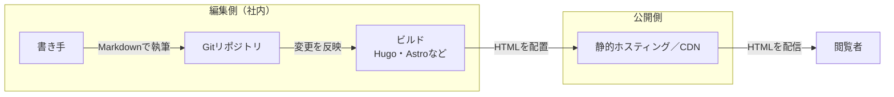
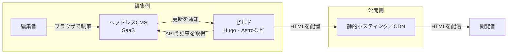
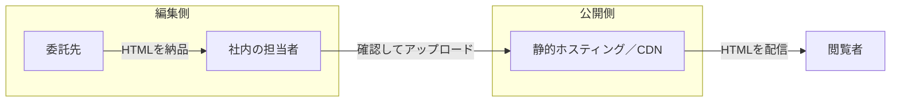

:::message
この記事は [codedchords.dev](https://codedchords.dev/blog/2026/10/after-php2shell-leaving-cms/) からの転載です。
:::

2026年10月21日、PHPの開発チームは、認証なしで任意のコードを実行できる深刻な脆弱性2件（CVE-2026-109618とCVE-2026-109619、通称「PHP2Shell」）を修正したバージョンを公開しました[^1]。WordPressをはじめとする、Webサイトの構築に使うContent Management System（以下、CMS）の多くはPHPの上で動いているため、影響は数えきれないほどのWebサイトに及びました。まともな企業であれば、すでにパッチを当て終えて一段落している頃でしょう。

では、次に同じような脆弱性が見つかったら、また慌ててパッチを当てるのでしょうか。この記事では、企業の製品情報やニュース、自治体のお知らせなど、記事が中心の情報発信サイトに絞って、長期的な再発防止策を考えます。

なお、情報発信ではなく業務に使うシステムは、動的な仕組みが必要になることがあるため、本記事では扱いません。

## パッチを当てて終わりでよいのか

PHP2Shellでこれほど被害が広がったのは、PHPで動くCMSが多くの組織のメインサイトで使われていたからです。WordPressに代表されるこうしたCMSで作られたサイトは、いたるところにあります。

パッチを当てれば、今回のPHP2Shell問題は塞げます。しかし、防げるのはその脆弱性だけです。PHP、CMS本体、プラグインのいずれにも、まだ見つかっていない脆弱性が残っています。PHP2Shellの発見には生成AIが使われました[^2]。生成AIの活用が広がれば、こうした脆弱性が見つかる頻度は今後大幅に上がっていくはずです。公開サーバーでPHPのような動的な仕組みが動いている限り、新しい脆弱性が見つかるたび、攻撃者より早くパッチを当てるという無限に続く競争に加わるしかありません。

しかも、その競争に毎回勝てるとは限りません。キャンペーンのために作って放置したサイトや、ブランド統合で使わなくなった旧サイトには、担当者すらいないことがあります。こうしたサイトはパッチ対応から漏れやすく、被害はたいていそこから広がります。

ここで一度立ち止まって考えてみてください。そもそも、そのサイトに動的な仕組みは必要なのでしょうか。

## 情報発信サイトに動的な仕組みは必須ではない

企業のメインサイトに載っているのは、製品情報やニュース、会社概要といった記事です。これらは誰がいつ見ても同じ内容で構いません。閲覧者ごとに表示を変える必要はありません。

内容が変わるのは、記事を更新したときだけです。更新が1日に何度あっても、そのたびにHTMLを書き出しておけば足ります。それなのにCMSで作ったサイトは、閲覧されるたびにサーバー上でPHPを動かし、DBから記事を取り出してページを組み立てています。この用途には過剰な構成です。

PHP2Shellの修正版が出た直後には、国税庁や気象庁、東京都や大阪市なども、一部のWebサービスを予防的に止めました[^3]。被害を防ぐための判断としては正しいでしょう。

しかし、自治体のサイトこそ、誰が見ても同じ情報を出すだけのサイトの典型です。それなのに多くの自治体は、技術構成が公開されていないパッケージCMSを、中身を把握しないまま調達しています。同じ構成のままなら、災害情報や行政手続きの案内を住民が必要とするときにも、同じ判断を迫られかねません。

## 情報発信サイトは静的サイトで十分

こうした情報発信サイトは、静的サイトで十分です。静的サイトとは、あらかじめ書き出したHTMLを配信するだけのサイトです。

静的サイトの公開側には、PHP、DB、管理画面のいずれもありません。PHP2Shellのような脆弱性は、そもそも届きようがありません。書き出したファイルは、静的ファイルの配信だけを行うホスティングサービスやCDNに置きます。Amazon S3とCloudFrontの組み合わせや、Cloudflare Pagesなどです。パッチを当てるべきサーバーを、自分たちで持つ必要はありません。

問い合わせフォームやサイト内検索のように、「動的でないと無理」と思われがちな機能もあります。これらも別の手段で賄えます。

CMSに頼らず静的サイトを運用する方法を、3つ紹介します。公開側の構成はどれも同じで、違うのは記事を書いてHTMLを書き出すまでの編集側です。どの方法を選ぶかは、誰が記事を書くか、既存の記事をどれだけ移行する必要があるか、移行にどれだけコストをかけられるかで決まります。

<!-- author-approved: 構成の選択肢と動的な機能の扱いを並べるため、この記事ではレベル3見出しを使う -->

### 静的サイトジェネレーター

HugoやAstroに代表される静的サイトジェネレーターを使う方法です。原稿をMarkdownで書いてGitで管理し、ビルドするとサイト全体のHTMLが書き出されます。サーバー側で動くものが何もないので攻撃面が小さく、費用も安く済みます。ただし、書き手がMarkdownやGitに慣れていないと運用が回りません。社内にエンジニアがいて、書き手も技術に抵抗がない組織に向いています。

### ヘッドレスCMSと静的サイトジェネレーター

ヘッドレスCMSと静的サイトジェネレーターを組み合わせる方法です。ヘッドレスCMSとは、記事を書いて管理する編集画面だけを提供し、閲覧者に見せるページは持たないCMSです。microCMSやContentfulがSaaSとして提供しています。

編集者はヘッドレスCMSの画面で記事を書き、静的サイトジェネレーターはビルドのときにAPIで記事を取り出してHTMLを書き出します。ヘッドレスCMSから更新を通知させておけば、記事を更新するたびにビルドが自動で走り、数分で公開側に反映されます。従来のCMSに近い操作で書けるので、エンジニアでない担当者が更新するサイトでも無理なく移行できます。

代わりに、SaaSのアカウントという新たに守るべき対象が生まれます。多要素認証を必須にし、権限を必要な人に絞っておく必要があります。

### 委託先から原稿を受け取る

そもそもCMSの利点は、HTMLの知識がない担当者でも、自分たちで記事を書いて更新できることにあります。ところが、CMSでサイトを作っておきながら、記事の執筆は外部に委託している企業や自治体が少なくありません。委託先が原稿を書き、CMSへの入力まで代行していることもあります。「Webサイトを作るにはCMSが必要」という程度の理由でCMSを選び、その利点をまったく使っていないのです。

使っていない利点のために、PHPやDB、管理画面、プラグインという攻撃の入口を抱えているわけです。それなら社内に編集画面を置く必要はありません。委託先から原稿を受け取り、静的に公開すれば足ります。委託先にはHTMLで納品してもらい、公開作業だけを社内で管理します。

### 動的な機能の扱い

問い合わせフォームは、フォーム用のSaaSを使うか、送信だけを受け付ける小さなサーバーレス関数で賄えます。サイト内検索は、ビルドのときに索引を作っておき、ブラウザ側で検索する方法があります。外部の検索サービスを使う手もあります。こうするとリスクは外部サービスやビルド時の依存パッケージに移ります。それでも、常時インターネットに公開されるサーバーを自分たちで抱えることはありません。

## まとめ

記事中心の情報発信サイトは、静的サイトを既定にすべきだと考えます。CMSは、使う理由がはっきりしている場合にだけ選ぶ、という順番です。

CMSを否定しているわけではありません。使う理由が明確で、抱えるリスクに見合うと判断できるなら、採用すればよいのです。ただしその場合は、動的な仕組みを持つ分の管理と責任を引き受けることになり、それに対応できる体制と仕組みも欠かせません。CMSやプラグインがどのような言語のどのバージョンに依存しているかすら把握できない組織には、残念ながら、もはやCMSを使う資格はありません。

ここで挙げた3つの方法は、どれも明日から切り替えられるものではありません。既存の記事の移行、デザインの作り直し、委託契約の見直しと、それなりの手間と予算がかかります。だからこそ、次年度に向けた計画を今から始めるべきです。多くの企業や自治体では、秋から冬にかけて次年度の予算を組みます。PHP2Shellの記憶が新しい今なら、予算も通しやすいはずです。

まず手をつけるべきは棚卸しです。自分たちの組織のどこでPHPが動いているかを洗い出し、放置されたサイトは廃止してください。そのうえで、残すサイトごとに移行先を決め、次年度の計画に載せます。

パッチ対応が一段落した今こそ、次の脆弱性に備えて構成を見直す時期です。

[^1]: [PHP: News Archive - 2026](https://www.php.net/archive/2026.php)

[^2]: [PHP2Shell: AI uncovers critical RCE vulnerabilities affecting 70% of the Internet](https://www.wiz.io/blog/php2shell-php-rce)、[Patch the Planet: global response coordination as agents uncover critical vulnerabilities](https://openai.com/index/coordinated-disclosure-of-critical-vulnerabilities/)

[^3]: [PHP脆弱性でサービス停止が相次いだ10月21〜22日、日本で何が起きたか｜レジット](https://www.legit.co.jp/php-vulnerability-japan-2026-10/)、[プログラミング言語「PHP」の重大な脆弱性に対する東京都の対応について](https://www.metro.tokyo.lg.jp/information/press/2026/10/2026102215)
