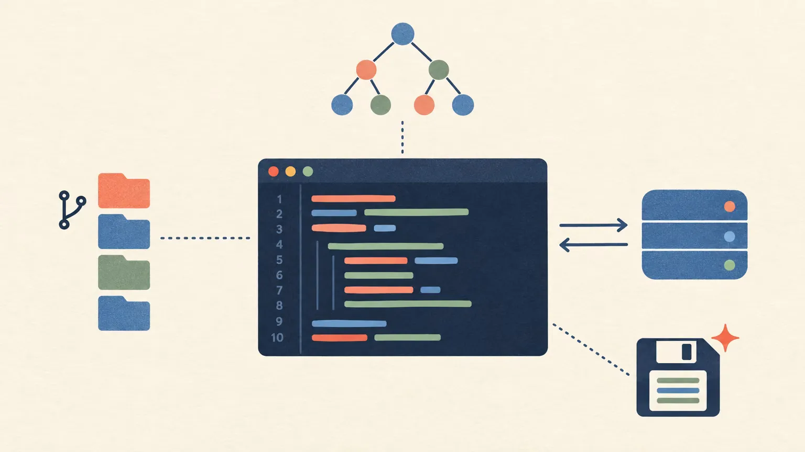

:::message
この記事は [codedchords.dev](https://codedchords.dev/blog/2026/10/emacs-init-el/04-emacs-init-dev/) からの転載です。連載「AI時代のEmacs設定術」の第4回です。

- 前回: [AI時代のEmacs設定術(3): EmacsでClaude CodeとLLMを操る](https://zenn.dev/yostos/articles/emacs-init-claude-code)
:::

開発用のエディタといえばVS Codeです。Emacsで同じことをしようとすると、パッケージをいくつも集めて、長い設定を書かなければならない。そう考えて、Emacsを候補から外している人も多いのではないでしょうか。

実際には、いまのEmacsはLSPクライアントのEglotも、構文解析のtree-sitterも、プロジェクト管理のproject.elも本体に備えています。私のinit.elで開発に使っている設定は、コメントを除けば80行に満たない量です。

連載「AI時代のEmacs設定術」の4回目となるこの記事では、開発に使う設定を、私のinit.elから抜き出して解説します。init.elの全体は[Gist](https://gist.github.com/yostos/631d858c283b1a15fc487f474c837a86)で公開しています。

## ghqのリポジトリをプロジェクトとして扱う

Emacs標準のproject.elは、開いているファイルが属するプロジェクトを見つけ、その範囲でコマンドを動かします。プロジェクトの判定にはGitなどのバージョン管理を使い、リポジトリのルートをプロジェクトのルートとみなします。

ただファイルを開くのと違うのは、操作の範囲がプロジェクトに揃うことです。`C-x p f`はプロジェクト内のファイルを名前で探して開き、`C-x p g`はプロジェクト全体を正規表現で検索します。`C-x p c`はルートでビルドコマンドを実行し、`C-x p s`はルートでシェルを開きます。`C-x p p`で別のプロジェクトに切り替え、`C-x p k`でそのプロジェクトのバッファをまとめて閉じます。いまどのディレクトリにいるかを気にする必要がなく、`.gitignore`で除外したファイルも候補に出ません。

私はリポジトリを`ghq`で管理し、GitHubやGitLabから`~/ghq`の下にcloneしています。ただ、project.elが一覧に覚えるのは、プロジェクトのコマンドを一度使ったリポジトリだけです。cloneしただけのリポジトリは`C-x p p`の候補に出ないので、まずそのリポジトリのファイルを開いてコマンドを使う必要があります。

そこで、`ghq list`のリポジトリをまとめて一覧に取り込むコマンドを書き、`C-x p R`に割り当てました。`ghq get`でcloneを増やしたら`C-x p R`を押すだけで、`C-x p p`から選べるようになります。

```elisp:init.el
(defun my/project-remember-ghq ()
  "`ghq list' のリポジトリを既知プロジェクト一覧に取り込む。
一度も開いていないリポジトリも C-x p p の候補に出すため。ghq で clone を増やしたら実行する。"
  (interactive)
  (unless (executable-find "ghq")
    (user-error "ghq が見つからない"))
  ;; project-current に prompt を渡さないので副作用はない
  (let ((n 0))
    (dolist (root (split-string (shell-command-to-string "ghq list -p") "\n" t))
      (when-let* ((pr (project-current nil (file-name-as-directory root))))
        (project-remember-project pr t)
        (setq n (1+ n))))
    (project--write-project-list)
    (message "ghq: %d 件を登録した" n)))

(use-package project
  :ensure nil
  ;; C-x p f / g / p などは内蔵の project-prefix-map をそのまま使うので明示しない。
  :bind (:map project-prefix-map
              ("R" . my/project-remember-ghq)))
```

## 構文解析をtree-sitterに切り替える

Emacs 29から、tree-sitterによる構文解析が標準で使えます。

従来のモードは主に正規表現で色付けしていましたが、ts-modeと呼ばれるモードは、コードを構文木に解析してから色付けやインデントを行います。そのため、入れ子が深いコードや複数行にまたがる式でも、色やインデントが崩れにくくなります。

Emacs 30までは、ts-modeを使うには文法を自分で入れ、`major-mode-remap-alist`で従来のモードと対応付ける必要がありました。Emacs 31では、`treesit-enabled-modes`に使うts-modeを並べるだけで従来のモードと置き換わります。この置き換えはOrg Babelのコードブロックにも適用されます。`treesit-auto-install-grammar`を`always`にしておけば、足りない文法も確認なしに入るので、新しいマシンでも設定を置くだけで揃います。

私はBash、Python、Rust、Go、TOMLで使っています。Markdownだけは、tree-sitter版のmarkdown-ts-modeが現時点で実験的な実装なので、従来のmarkdown-modeを使っています[^1]。

```elisp:init.el
(use-package treesit
  :ensure nil
  :custom
  ;; 文法がなければ確認せずに入れる（新しいマシンでも自動で揃う）
  (treesit-auto-install-grammar 'always)
  ;; 従来のモードをこれらの ts-mode に置き換える（Org Babel のブロックにも効く）。
  ;; :set 関数を持つ変数なので setq ではなく :custom で設定する
  (treesit-enabled-modes '(bash-ts-mode python-ts-mode
                           rust-ts-mode go-ts-mode go-mod-ts-mode
                           toml-ts-mode)))
```

## LSPで補完と定義ジャンプと診断を使う

LSP（Language Server Protocol）は、エディタと言語サーバーの間で、補完や定義の場所などの情報をやり取りする取り決めです。言語ごとの解析は言語サーバーが受け持つので、エディタはLSPに対応するだけで、多くの言語で同じ機能を使えます。

Emacs 29から、LSPクライアントのEglotが標準で入っています。Python、Rust、Goのファイルを開くと`eglot-ensure`が言語サーバーを起動し、補完、定義へのジャンプ、診断の表示が使えます。言語サーバーは、Pythonにbasedpyright、Rustにrust-analyzer、Goにgoplsを使っています。basedpyrightは`uv tool install`で、ほかの2つはmiseで入れています。

EglotはEmacs標準の仕組みに情報を渡して動くので、新しく覚える操作は多くありません。

- 補完: `completion-at-point`に候補を渡す。私の環境ではcorfuのポップアップに出る。corfuの設定は、UIまわりの設定を解説する回で扱う
- 定義へのジャンプ: `M-.`で定義へ飛び、`M-,`で戻る。`M-?`で参照箇所を一覧する（xref）
- ドキュメント: カーソル位置の関数の引数や説明をエコーエリアに出す（eldoc）
- 診断: エラーや警告の箇所に印を付ける（flymake）。`M-n`と`M-p`で前後の診断へ移動する
- 名前の変更と修正: `M-x eglot-rename`で識別子の名前をまとめて変え、`M-x eglot-code-actions`で言語サーバーが提案する修正を当てる

設定では、`eglot-autoshutdown`を有効にして、そのサーバーを使うバッファをすべて閉じたらサーバーも止まるようにしています。また、サーバーとの通信のログを取らないようにしました。やり取りの多いサーバーでは、ログを書くだけでEmacsが重くなるからです。不具合を調べるときだけ、ログを戻します。

言語サーバーとの通信は、eglot-boosterでさらに軽くしています。言語サーバーはJSONでやり取りしますが、大きなJSONを解析するのはEmacsにとって重い処理です。eglot-boosterを使うと、外部プログラムのemacs-lsp-boosterが言語サーバーとの間に入り、JSONをEmacsが速く読めるElispのバイトコードに変えてから渡します。emacs-lsp-boosterもmiseで入れており、入っていないマシンではeglot-boosterを読み込みません。

```elisp:init.el
(use-package eglot
  :ensure nil
  :hook (((python-mode python-ts-mode) . eglot-ensure)
         (rust-ts-mode . eglot-ensure)
         (go-ts-mode . eglot-ensure))
  :custom
  ;; サーバーを使う最後のバッファを閉じたらサーバーも終了する
  (eglot-autoshutdown t)
  ;; サーバーとのやり取りのログを取らない（多弁なサーバーで軽くなる）。
  ;; 不具合を調べるときは '(:size 2000000) などに戻して *EGLOT events* を見る
  (eglot-events-buffer-config '(:size 0)))

;; LSP サーバーとの JSON のやり取りを外部プロセスで肩代わりして軽くする
(use-package eglot-booster
  :if (executable-find "emacs-lsp-booster")
  :vc (:url "https://github.com/jdtsmith/eglot-booster" :rev :newest)
  :after eglot
  :config
  (eglot-booster-mode 1))

;; 診断（eglot は flymake で出す）の間を移動する
(use-package flymake
  :ensure nil
  :bind (:map flymake-mode-map
              ("M-n" . flymake-goto-next-error)
              ("M-p" . flymake-goto-prev-error)))
```

## 保存するたびにコードを自動で整形する

apheleiaを有効にすると、保存するたびに言語ごとのフォーマッタでコードを整形します。フォーマッタを`before-save-hook`で動かす方法もありますが、整形が終わるまで保存を待たされ、カーソルがバッファの先頭に戻ってしまうことがあります。apheleiaは保存した後にフォーマッタを非同期で動かし、整形前との差分だけをバッファに当ててから、もう一度保存します。そのため保存のたびに待たされず、カーソルも周りの文字との位置関係を保ったまま残ります。

どの言語にどのフォーマッタを使うかはapheleiaが最初から決めているので、私の設定は有効にする一行だけです。私が使っている言語では、次のフォーマッタが動きます。

- Python: black
- Rust: rustfmt
- Go: gofmt
- Bash: shfmt
- TOML: taplo

フォーマッタそのものはapheleiaに含まれていないので、別に入れておく必要があります。入っていないと、保存しても整形されません。私はblackを`uv tool install`で、shfmtをmiseで、taploをHomebrewで入れています。rustfmtとgofmtは、miseで入れたRustとGoに付いてきます。

```elisp:init.el
(use-package apheleia
  :config
  (apheleia-global-mode 1))
```

## Gitの操作をEmacsの中で済ませる

Magitは、Gitの操作をEmacsのバッファで行うパッケージです。`C-x g`で開くステータス画面に、いまのブランチ、未追跡のファイル、ステージ前とステージ済みの変更が並びます。ファイルの上で`TAB`を押すとその場で差分が開くので、何をコミットするのかを確かめながら作業できます。

ステージは`s`、取り消しは`u`です。ファイルの上で押せばファイルごと、差分のハンク（変更のまとまり）の上で押せばそのハンクだけ、範囲を選んでから押せばその行だけをステージします。コマンドラインの`git add -p`より手軽に、1つのファイルの変更を複数のコミットに分けられます。

コミットは`c c`で始め、メッセージを書いて`C-c C-c`で確定し、`C-c C-k`で取りやめます。`P`を押すとプッシュの、`F`を押すとプルのメニューが開きます。メニューには次に押せるキーとオプションが並ぶので、コマンドを覚えていなくても迷いません。ほかにも`l`でログを、`b`でブランチの操作を、同じようにメニューから選べます。

`C-x M-g`の`magit-dispatch`は、ステータス画面を開かずに、いま編集しているバッファからMagitのメニューを呼び出します。`C-x g`と`C-x M-g`はMagitが最初から割り当てているキーなので、設定はパッケージを入れるだけです。

```elisp:init.el
(use-package magit)
```

## 編集を助ける小さなパッケージを入れる

開発に直接かかわるものではありませんが、コードを書く手間を減らす小さなパッケージもいくつか入れています。

- avy: 画面内の好きな位置へ数打鍵でジャンプする。`M-j`を押して行き先の文字を数文字打ち、少し待つと一致した箇所にラベルが出るので、そのラベルを打つ。`M-g l`は行の先頭へ、`M-g w`は単語の先頭へ飛ぶ。isearchの途中で`M-j`を押すと、一致した箇所をラベルで選べる
- expreg: `C-=`を押すたびに、選択範囲を単語、文字列、式、関数と意味の単位で広げる。`C-+`で一段戻す。tree-sitterのモードでは構文木をもとに範囲を決める
- vundo: `C-x u`でundoの履歴をツリーとして表示する。Emacsのundoは、取り消しの操作も履歴に積むので、何度か戻したり進めたりすると目的の状態を見失いやすい。vundoではツリーの上を`f`と`b`で移動するとバッファがその状態に変わり、`RET`で確定する。`q`で抜けると元の状態に戻る
- helpful: `C-h f`、`C-h v`、`C-h k`などのヘルプを、ソースコード、呼び出し元、割り当てられたキーまで載せた表示に置き換える。設定を書くときに、関数の中身を確かめる手間が省ける
- visual-replace: `M-%`で置換前と置換後の文字列を同じミニバッファで入力する。入力している間も、置換の結果がバッファにプレビューされる。isearchの途中で`M-%`を押すと、検索中の文字列から置換を始める
- yasnippet: 決まったキーワードを打って`TAB`を押すと、定型文に展開する。展開した後も、`TAB`で次の入力欄へ移れる。各言語向けのスニペット集のyasnippet-snippetsもあわせて入れている

```elisp:init.el
;; 画面内の文字へ数打鍵でジャンプする
(use-package avy
  :bind (("M-j"   . avy-goto-char-timer) ; 数文字打って少し待つと候補にラベルが出る
         ("M-g l" . avy-goto-line)
         ("M-g w" . avy-goto-word-1)
         :map isearch-mode-map
         ;; isearch の一致箇所をラベルで選ぶ
         ("M-j" . avy-isearch)))

;; 選択範囲を意味の単位で広げる・狭める（tree-sitter 対応）
(use-package expreg
  :bind (("C-=" . expreg-expand)
         ("C-+" . expreg-contract)))

;; undo の履歴をツリーで表示して辿る
(use-package vundo
  :bind ("C-x u" . vundo)
  :custom
  (vundo-glyph-alist vundo-unicode-symbols))

;; C-h f / v / k / x / o をソース・参照元つきの表示に置き換える
(use-package helpful
  :bind (([remap describe-function] . helpful-callable)
         ([remap describe-variable] . helpful-variable)
         ([remap describe-key]      . helpful-key)
         ([remap describe-command]  . helpful-command)
         ([remap describe-symbol]   . helpful-symbol)))

;; 置換前後をバッファ上で確認しながら進める
(use-package visual-replace
  :bind (("M-%" . visual-replace)
         :map isearch-mode-map
         ("M-%" . visual-replace-from-isearch)))

(use-package yasnippet
  :config
  (yas-global-mode 1))

;; 各言語向けの既製スニペット集
(use-package yasnippet-snippets)
```

## まとめ

いまのEmacsは、開発に必要な機能の多くを標準で備えています。プロジェクトの管理はproject.el、構文解析はtree-sitterが受け持ちます。補完、定義へのジャンプ、診断を受け持つのはEglotとflymakeです。Emacs 31ではtree-sitterの文法も自動で入るので、標準の機能は有効にして好みに合わせて調整するだけで済みました。

私が足したのは、ghqのリポジトリを一覧に取り込む小さなコマンドと、Eglotを軽くするeglot-booster、保存時に整形するapheleia、Gitを操作するMagitくらいです。ただし、言語サーバーとフォーマッタはEmacsの外のツールなので、言語ごとに別途入れておく必要があります。

次回は、Emacsでメール、Web、RSSを読む設定を扱います。

[^1]: Emacs 31にもmarkdown-ts-modeは入っていますが、説明に「実験的なモードで未解決の問題があるため、既定では有効にしない」とあり、`treesit-enabled-modes`の選択肢にも含まれていません。プレビューの機能もありません。

## References

確認日はいずれも2026年10月18日です。

- [GNU Emacs Manual](https://www.gnu.org/software/emacs/manual/html_node/emacs/Projects.html). "Projects"
- [ghq](https://github.com/x-motemen/ghq)
- [GNU Emacs Lisp Reference Manual](https://www.gnu.org/software/emacs/manual/html_node/elisp/Parsing-Program-Source.html). "Parsing Program Source"
- [Eglot Manual](https://www.gnu.org/software/emacs/manual/html_node/eglot/)
- [eglot-booster](https://github.com/jdtsmith/eglot-booster)
- [emacs-lsp-booster](https://github.com/blahgeek/emacs-lsp-booster)
- [basedpyright](https://github.com/DetachHead/basedpyright)
- [apheleia](https://github.com/radian-software/apheleia)
- [Magit](https://magit.vc/)
- [avy](https://github.com/abo-abo/avy)
- [expreg](https://github.com/casouri/expreg)
- [vundo](https://github.com/casouri/vundo)
- [helpful](https://github.com/Wilfred/helpful)
- [visual-replace](https://github.com/szermatt/visual-replace)
- [yasnippet](https://github.com/joaotavora/yasnippet)
- [yasnippet-snippets](https://github.com/AndreaCrotti/yasnippet-snippets)
