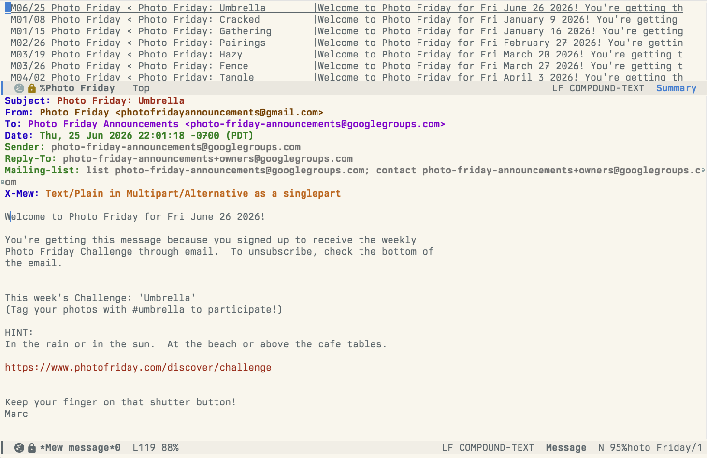

:::message
この記事は [codedchords.dev](https://codedchords.dev/blog/2026/10/emacs-init-el/05-emacs-init-reading/) からの転載です。連載「AI時代のEmacs設定術」の第5回です。

- 前回: [AI時代のEmacs設定術(4): Emacsでモダンな開発環境を構築する](https://zenn.dev/yostos/articles/emacs-init-dev)
:::

メールも、RSSで集めた記事も、Webのページも、Emacsのバッファで読めます。バッファで読めば、ふだんの編集と同じキー操作で文章を選び、[2回目](https://zenn.dev/yostos/articles/emacs-init-org)で紹介したOrg modeのメモに書き留めたり、[3回目](https://zenn.dev/yostos/articles/emacs-init-claude-code)で紹介したClaude Codeやgptelに渡したりできます。

連載「AI時代のEmacs設定術」の5回目となるこの記事では、メールをMewで、RSSをElfeedで、WebのページをEmacs標準のEWWで読む設定を解説します。設定は私のinit.elから抜き出しています。コード中の`……（省略）……`は、話題に関係しない設定を省いた箇所です。init.elの全体は[Gist](https://gist.github.com/yostos/631d858c283b1a15fc487f474c837a86)で公開しています。

## Mewでメールを読み書きする

Mewは、日本人の山本和彦氏が開発した、Emacsで動くメールクライアントです。

現在も開発が続いており、メールに関するRFCなどの規約にきちんと準拠した優れたメールクライアントです。私は1990年代にMewを使っていて慣れていたので、今回もメールにはMewを選びました。MELPAにあるので、`use-package`に書けば使い始められます。


_Mewでメールを読む画面_

MewはIMAPとSMTPでサーバーと直接やりとりするので、サーバーとの同期を外部コマンドに頼りません。受信にはIMAPを、送信にはSMTPを使い、どちらもTLSで接続します。`mew-imap-ssl`と`mew-smtp-ssl`に`native`を指定すると、Emacsが内蔵するGnuTLSで直接サーバーと接続します。

私が使用しているFastmailに外部のメールクライアントから接続するときは、Fastmailで発行したアプリパスワードを使って認証します。Mewは既定でXOAUTH2による認証を最初に試すので、認証方式の一覧からXOAUTH2を外しました。アプリパスワードは、初めて接続するときに入力します。`mew-use-master-passwd`を`t`にしておくと、入力したパスワードはマスターパスワードで暗号化され、`~/Mail/.mew-passwd.gpg`に保存されます。

Mewは、フォルダー名の先頭の記号でフォルダーの種類を区別します。`%`で始まるのがIMAPのフォルダー、`+`で始まるのが手元のフォルダーです。`mew-proto`に`"%"`を指定して、IMAPを既定にしています。`d`で削除の印を付けたメールはゴミ箱のフォルダーに移ります。Mewが既定で使うゴミ箱は`%trash`ですが、Fastmailのゴミ箱は`Trash`です。IMAPのフォルダー名は大文字と小文字を区別するため、`%Trash`を指定しました。送ったメールの控えはFastmailが送信済みのフォルダーに保存するよう設定しているので、Mewで控えを保存する`mew-fcc`は設定していません。

Mewは、日本語のメールをISO-2022-JPで送るのが既定です。ISO-2022-JPでは丸数字や絵文字を表せないので、US-ASCIIだけのメールはそのまま送り、それ以外はUTF-8で送るようにしています。

```elisp:init.el
(use-package mew
  :commands (mew mew-send)
  ;; ……（省略）……
  :init
  ;; 差出人（mew-name は Fastmail 側の設定で上書きされる）
  (setq mew-name "Your Name")
  (setq mew-user "user")
  (setq mew-mail-domain "example.com")

  ;; 既定のプロトコルを IMAP にする
  (setq mew-proto "%")

  ;; 認証方式から XOAUTH2 を外す（Fastmail はアプリパスワードで入る）
  (setq mew-imap-auth-list '("CRAM-MD5" "LOGIN"))
  (setq mew-smtp-auth-list '("CRAM-MD5" "PLAIN" "LOGIN"))

  ;; 受信（IMAP over TLS）
  (setq mew-imap-server "imap.fastmail.com")
  (setq mew-imap-user "user@example.com")
  (setq mew-imap-ssl 'native)
  (setq mew-imap-ssl-port "993")

  ;; 送信（SMTP over TLS）。送信済みの保存は Fastmail 側でやるので mew-fcc は設定しない
  (setq mew-smtp-server "smtp.fastmail.com")
  (setq mew-smtp-user "user@example.com")
  (setq mew-smtp-ssl 'native)
  (setq mew-smtp-ssl-port "465")

  ;; d で削除したメールはサーバーの Trash に移す。
  ;; 既定の "%trash" は Fastmail に無い（IMAP のフォルダー名は大小を区別する）
  (setq mew-imap-trash-folder "%Trash")
  ;; ……（省略）……

  ;; パスワードはマスターパスワードで暗号化して保存する（~/Mail/.mew-passwd.gpg）
  (setq mew-use-master-passwd t)

  ;; US-ASCII 以外は UTF-8 で送る
  (setq mew-cs-database-for-encoding
        `(((ascii) nil "7bit" "7bit")
          (nil utf-8 "base64" "B"))))
```

## HTMLメールの表示も可能

MewはHTMLメールも表示できます。ただし既定では、HTMLメールを開くと本文の代わりに「HTML」という大きな文字が表示され、`.`を押すまで中身は表示されません。`mew-use-text/html`を`t`にしておくと、開いたときからHTMLを解釈して表示します。

HTMLの描画には、Emacsが内蔵するHTMLレンダラーのshrを使います。shrはHTMLをEmacsのバッファのテキストに変換するので、本文はウィンドウの幅に合わせて折り返され、ふつうのテキストと同じように検索やコピーができます。HTMLメールは文字や背景の色を細かく指定していることが多く、そのまま表示するとEmacsのテーマと合わずに読みにくくなります。そこで`shr-use-colors`を`nil`にして、メールの色の指定は使わず、テーマの配色で表示しています。

shrは画像も表示できます。ただ、HTMLメールの画像の多くはメールに含まれておらず、送信者のサーバーから読み込む外部画像です。外部画像を読み込むと、メールを開いたことと、その日時やIPアドレスが送信者に伝わります。広告やニュースレターのメールには、開封を知るためだけに置いた目に見えない小さな画像（トラッキングピクセル）が仕込まれていることもあります。そこで`shr-inhibit-images`を`t`にして、メールを開いても画像は読み込まず、画像の代わりに代替テキストを表示するようにしました。どうしても見たい画像は、代替テキストの上で`I`を押せば、その画像だけを読み込んで表示できます。

この2つの変数は、`let`で値を変えてからshrを呼ぶ関数`my/mew-shr-render-region`の中でだけ設定しています。init.el全体で設定すると、EWWなどshrを使うほかの機能にも効いてしまうからです。この関数を`mew-prog-text/html`に指定しているので、MewはHTMLを描画するときこの関数を呼びます。

```elisp:init.el
;; lexical-binding 下でも let が動的束縛になるよう宣言しておく
(defvar shr-inhibit-images)
(defvar shr-use-colors)

(defun my/mew-shr-render-region (begin end)
  "外部画像を読まず、配色もテーマに任せて HTML を描画する。
外部画像を読むと開封が送信者に伝わる（トラッキングピクセル）。"
  (let ((shr-inhibit-images t)
        (shr-use-colors nil))
    (shr-render-region begin end)))

(use-package mew
  ;; ……（省略）……
  :init
  ;; ……（省略）……
  ;; HTML メールは Emacs 内蔵の shr で描画する（画像は読まない。上の関数を参照）
  (setq mew-use-text/html t)
  (setq mew-prog-text/html #'my/mew-shr-render-region)
  ;; ……（省略）……
  )
```

## 日本語と英語の署名を切り替える

Mewには、書いているメールの本文に署名を入れる機能があります。`mew-signature-file`に署名のファイルを指定し、`mew-signature-insert-last`を`t`にしておくと、`C-c TAB`で本文の末尾に署名が入ります。私は、メールを書き始めたときに署名が自動で入るように、`mew-draft-mode-newdraft-hook`に署名を入れる関数を登録しています。

署名は、日本語と英語の2つをファイルに分けて用意しています。メールを書き始めると日本語の署名が入るので、英語で書くときは`C-c TAB`を押し、補完で`en`を選び直します。`C-c TAB`には、Mewの既定の署名を入れるコマンドの代わりに、署名を選んで入れ直す関数`my/mew-signature-insert`を割り当てました。

署名ファイル（`~/Mail/.signature`）には、次のようにハイフン2つと空白1つだけの行を1行目に入れてください。

```text:~/Mail/.signature
-- 
山田 太郎
user@example.com
https://example.com
```

1行目にこの行が必要なのは、RFC 3676などで署名の始まりを示す行と決められており、署名の処理がこれを前提としているためです。署名を増やすときは、`my/mew-signature-alist`に名前とファイルの組を1行足すだけです。

```elisp:init.el
(defvar my/mew-signature-alist
  '(("ja" . "~/Mail/.signature")
    ("en" . "~/Mail/.signature.en"))
  "Mew で切り替える署名ファイル。左が補完で選ぶ名前。")

(defun my/mew-signature-insert (key)
  "署名を選んで入れ直す。すでに入っている署名は取り除く。"
  (interactive
   (list (completing-read "Signature: " my/mew-signature-alist nil t)))
  (save-excursion
    (goto-char (point-max))
    (when (re-search-backward "^-- $" nil t)
      (delete-region (point) (point-max))))
  (let ((mew-signature-file (cdr (assoc key my/mew-signature-alist))))
    (mew-draft-insert-signature)))

(use-package mew
  :commands (mew mew-send)
  :bind (:map mew-draft-mode-map
              ("C-c TAB" . my/mew-signature-insert))
  :hook (mew-draft-mode-newdraft . mew-draft-insert-signature)
  :init
  ;; ……（省略）……
  ;; 署名は本文の末尾に入れる
  (setq mew-signature-file "~/Mail/.signature")
  (setq mew-signature-insert-last t)
  ;; ……（省略）……
  )
```

## メールをEmacsで扱うメリット

Emacsでメールを扱うメリットは、大きく3つあります。

1つ目は、メールをいつもの編集環境で書けることです。メールは、RSSやWebの記事と違って、読むだけでなく自分で書くものでもあります。Mewでは、メールを書く画面もEmacsのふつうのバッファです。日本語入力、検索や置換、スニペットといった機能を、いつもの設定とキー操作のまま使えます。メールのためだけに、別のエディタの操作を覚える必要はありません。

2つ目は、メールを書くときに生成AIの手を借りられることです。[3回目](https://zenn.dev/yostos/articles/emacs-init-claude-code)で紹介したgptelやclaude-code.elは、メールを書く画面でもそのまま使えます。書きかけの文章を選んで渡せば、敬語の手直しや英訳をその場で頼めます。伝えたい要点だけを書いて渡し、メールの文面に整えてもらうこともできます。

3つ目は、受け取ったメールをほかのテキストと同じように扱えることです。メールの本文もEmacsのバッファのテキストなので、ふだんの編集と同じキー操作で選んだりコピーしたりできます。長いメールの要約を生成AIに頼んだり、必要な部分をOrg modeのメモやタスクに書き留めたりできます。ウィンドウを分ければ、メールを読みながら、その横でOrg modeのメモを書くこともできます。

## Emacsをニュースリーダーにする

ニュースサイトやブログの多くは、新しい記事の見出しや本文を、RSSやAtomという決まった形式で配信しています。この配信先のURL（フィード）を登録しておけば、サイトを1つずつ見に行かなくても、新しい記事をまとめて読めます。フィードを集めて読むためのソフトが、ニュースリーダーです。

Emacsのニュースリーダーには、Elfeedを使います。ElfeedはMELPAにあるので、`use-package`に書き、`elfeed-feeds`に読みたいサイトのフィードのURLを並べておけば使い始められます。

`C-x w`でElfeedを開くと、記事の一覧が表示されます。一覧には、既定では過去6か月の未読の記事が新しい順に並びます。`RET`で記事を開くと、本文がEmacsのバッファに表示されます。本文の描画には、HTMLメールと同じshrを使います。記事の本文もEmacsのバッファのテキストなので、気になった部分はそのままOrg modeのメモやLLMへの入力に回せます。

一覧と記事のバッファでよく使うキーは、次のとおりです。

- `RET`: 一覧で選んだ記事を開く
- `b`: 記事の元のページをブラウザで開く
- `G`: すべてのフィードから新しい記事を取り込む
- `s`: 一覧を絞り込む条件を書き換える
- `r` / `u`: 一覧で選んだ記事を既読／未読にする
- `q`: 記事や一覧を閉じる

Elfeedは、開いただけでは新しい記事を取り込みません。開くたびに`G`を押すのは手間なので、開くことと取り込むことを1つにまとめた関数`my/elfeed-open-and-update`を用意しました。取り込みは裏で進み、届いた記事から一覧に加わるので、取り込みが終わるのを待たずに読み始められます。私はこの関数を、Emacsの起動時の画面（dashboard）のボタンから呼んでいます。

Elfeedは、取り込んだ記事をデータベースに保存します。既定の保存先は、ホームディレクトリの直下の`~/.elfeed`です。私は、バックアップや自動保存のファイルと同じく、Emacsが作るデータを`~/.local/share`の下にまとめているので、`elfeed-db-directory`で保存先を`~/.local/share/elfeed`に変えています。

```elisp:init.el
(defun my/elfeed-open-and-update ()
  "elfeed を開き、全フィードの取得を始める（取得は裏で進み、届いた順に一覧に出る）。"
  (interactive)
  (elfeed)
  (elfeed-update))

(use-package elfeed
  :bind ("C-x w" . elfeed)
  :custom
  ;; 記事の DB は設定ディレクトリに置かない（backups などと同じ方針）
  (elfeed-db-directory "~/.local/share/elfeed")
  (elfeed-feeds
   '("https://example.com/feed.xml"           ; サンプル A
     "https://example.org/rss"                ; サンプル B
     "https://blog.example.net/atom.xml")))   ; サンプル C
```

## WebページをEmacsで読む

EWWは、Emacsに標準で入っているWebブラウザです。パッケージを追加する必要はなく、init.elに設定を書かなくても使えます。

`M-x eww`を実行してURLを入れると、そのページをEmacsのバッファに表示します。URLの代わりに言葉を入れると、DuckDuckGoで検索した結果を表示します。描画には、HTMLメールと同じshrを使います。Mewの節で外部画像を読み込まない設定をしましたが、この設定はMewの中だけで効くようにしているので、EWWではページの画像と色がそのまま表示されます。

EWWはJavaScriptを動かさず、CSSによる見た目の指定もほとんど使いません。そのため、見た目に凝ったサイトや、JavaScriptで中身を組み立てるサイトは、うまく表示できないことがあります。その代わり、広告や動く部品に邪魔されず文章を読めるので、ブログやドキュメントのような文章が中心のページに向いています。本文の周りのメニューなどが多くて読みにくいときは、`R`を押します。EWWがページの中から本文らしい部分だけを取り出して表示します。

表示したページもEmacsのバッファのテキストなので、メールやニュースリーダーの記事と同じように、選んだ部分をOrg modeのメモに書き留めたり、LLMに渡したりできます。

EWWでよく使うキーは、次のとおりです。

- `RET`: カーソルの位置のリンクを開く
- `TAB`: 次のリンクに移る
- `l` / `r`: 前のページに戻る／次のページに進む
- `g`: ページを読み込み直す
- `R`: 本文だけを表示する
- `&`: 表示しているページをふだんのブラウザで開く
- `w`: ページのURLをコピーする
- `q`: EWWを閉じる

## まとめ

この記事では、メール、ニュースリーダー、WebのページをEmacsで読むための設定を紹介しました。

- メール：MewでFastmailにIMAPとSMTPで直接つなぐ。HTMLメールは外部画像を読み込まずに表示し、署名は日本語と英語を切り替える
- ニュースリーダー：Elfeedにフィードを登録し、開くと同時に新しい記事を取り込む
- Web：Emacs標準のEWWで、設定を書かずに文章が中心のページを読む

どれも、読んだ文章がEmacsのバッファのテキストになる点は同じです。ブラウザやメールアプリから文章をコピーしてアプリを切り替えなくても、ふだんの編集と同じキー操作で選び、Org modeのメモに書き留めたり、gptelやClaude Codeに渡したりできます。メールの場合は、書くときにもいつもの編集環境と生成AIの手助けが使えます。

連載の冒頭で、生成AIの時代のエディタには、あちこちに散らばるテキストを集めるハブの役割が求められると書きました。メールや記事という情報の入り口をEmacsにまとめると、集めたテキストをOrg modeで整理し、LLMの手を借りて成果物に仕上げるまでを、1つの環境の中で進められます。

## References

確認日はいずれも2026年10月19日です。

- [Mew](https://mew.org/)
- [Fastmail](https://www.fastmail.help/hc/en-us/articles/360058752854-App-passwords). "App passwords"
- [Fastmail](https://www.fastmail.help/hc/en-us/articles/1500000278342-Server-names-and-ports). "Server names and ports"
- [RFC 3676](https://www.rfc-editor.org/rfc/rfc3676). "The Text/Plain Format and DelSp Parameters"
- [Elfeed](https://github.com/skeeto/elfeed)
- [EWW Manual](https://www.gnu.org/software/emacs/manual/html_mono/eww.html)
